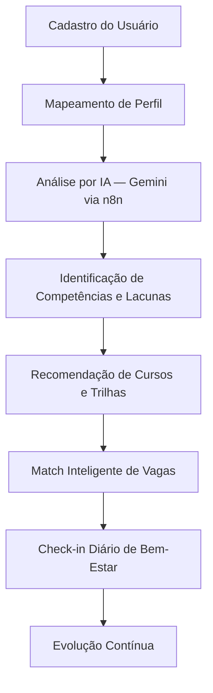
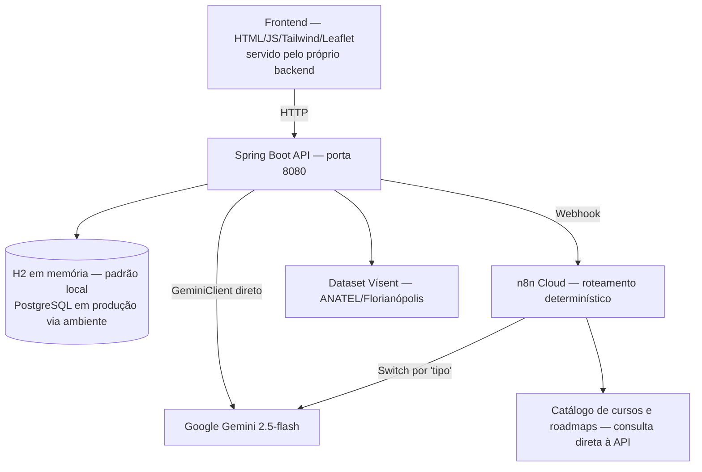

# 🌐 BiT App — Ecossistema Inteligente de Desenvolvimento Humano e Profissional

<p align="center">
  <strong>Conectando pessoas, oportunidades e bem-estar através da tecnologia.</strong>
</p>

<p align="center">
  Desenvolvido durante o Hackathon App BiT (Black in Tech) — Wongola EdTech<br/>
  Parceiros: Oracle Next Education (ONE) e No Country • Equipe 68
</p>

<p align="center">
  🔗 <strong>Demonstração ao vivo:</strong> <a href="https://s06-26-appbit-demo.onrender.com">s06-26-appbit-demo.onrender.com</a><br/>
  <em>Crie sua conta em segundos pelo "Primeiro Acesso". A instância já vem povoada com vagas, cursos e perfis de exemplo.</em><br/>
  <em>Hospedado no plano gratuito do Render: o primeiro acesso após inatividade pode levar ~1 minuto para o serviço acordar.</em>
</p>

---

# 🔧 Depois do hackathon

A tag `fim-hackathon-2026-07-25` marca o estado entregue ao fim do hackathon (Demo Day + Fase 2). O que foi corrigido depois, por grupo e com o motivo:

**Segurança e dados pessoais** — a revisão técnica mostrou que o servidor confiava no `usuarioId` enviado pelo navegador e que saúde mental, assessments, mentorias e a lista de usuários estavam abertos, sem login.

* `GET /api/usuarios` foi removida: devolvia nome, e-mail, cidade e WhatsApp de todos os cadastros, e nenhuma tela a usava.
* Saúde, assessment, mentorias, sugestões, rede, match de vagas, orientação e rota passaram a exigir login. O usuário vem do token; um `usuarioId` de outra pessoa responde 403 e, sem token, 401. Catálogo (vagas, cursos, roadmaps, lazer, mentores) e estáticos seguem públicos.
* `JWT_SECRET` não tem mais valor padrão (a aplicação não sobe sem ele); o CORS ficou numa só configuração, com origens vindas de `APP_CORS_ALLOWED_ORIGINS` e sem curinga; o console H2 vem desligado e fora das rotas públicas; o `X-Frame-Options` voltou.
* Texto digitado pelo usuário e texto devolvido pelos agentes (n8n/Gemini) passam por escape antes de ir para HTML; o log do n8n não registra mais o relato do check-in; o service worker deixou de guardar respostas de `/api/`.

**CVV** — o painel só aparecia depois da resposta do backend, que espera o n8n e o Gemini: a decisão sempre foi determinística, mas a entrega dependia dessa espera.

* Com nota 1 ou 3 o painel do CVV aparece na hora, calculado no navegador com os mesmos limites do backend, antes e independente da resposta. A resposta só atualiza a mensagem de acolhimento e a tendência da semana.
* Falha, timeout ou sessão vencida não tiram o painel da tela; o modal da nota 1 já traz o 188; fechar o Bit não descarta o painel.
* Toda chamada do frontend à API tem timeout de 15 s. A regra de derivação no backend não mudou.

**Integração com o n8n** — o workflow respondia com uma lista e o backend esperava outro formato, então descartava a resposta do agente e caía no Gemini direto.

* Contrato alinhado (`{mensagem, acaoSugerida}` no acolhimento), com exemplos em `backend/src/test/resources/contracts/n8n/` e testes de contrato.
* Webhook com autenticação por cabeçalho (`X-Webhook-Token`, enviado se `N8N_WEBHOOK_TOKEN` existir); URL do app lida da variável `BITAPP_BASE_URL` do n8n; timeout de 15 s e 1 tentativa por padrão; URL do n8n vazia pula o n8n e vai direto ao Gemini.
* O teste ponta a ponta contra o n8n real ainda não foi feito.

**PWA e mapa**

* `icon-192.png` e `icon-512.png` agora respondem sem token, que é o que o manifest precisa para o app ser instalável.
* O botão de rota do mapa chamava uma variável que não existia no módulo e sempre caía no Google Maps. Agora passa por `POST /api/rota` com o token; sem login ou sem `ORS_API_KEY`, abre o Google Maps.

**Organização e documentação** — scripts movidos para `scripts/`, guia antigo para `docs/`, contrato OpenAPI com a coluna de acesso corrigida e o termo "RAG" trocado por "consulta à base curada", já que roadmaps e catálogo são consultas diretas, sem busca por similaridade.

---

# 📖 Sobre o Projeto

O **BiT App** é uma plataforma digital desenvolvida para promover inclusão, desenvolvimento profissional e qualidade de vida através de uma abordagem integrada e inteligente.

Diferente das plataformas tradicionais focadas apenas em empregabilidade, o BiT App atua como um **ecossistema 360°**, conectando:

✅ Formação Profissional

✅ Orientação de Carreira

✅ Empregabilidade

✅ Saúde Mental

✅ Infraestrutura Tecnológica Regional

✅ Inteligência Artificial (Google Gemini, orquestrada via n8n)

Nosso objetivo é reduzir barreiras de acesso ao mercado de trabalho, oferecendo recomendações personalizadas, suporte emocional preventivo e acesso inteligente a oportunidades compatíveis com o perfil de cada usuário.

---

# 🎯 Problema

Milhões de pessoas enfrentam desafios simultâneos ao buscar crescimento profissional:

* Falta de orientação de carreira;
* Dificuldade para identificar lacunas técnicas;
* Escassez de oportunidades compatíveis;
* Problemas emocionais causados por pressão profissional;
* Limitações de infraestrutura digital em determinadas regiões.

Atualmente essas soluções encontram-se fragmentadas em diversas plataformas.

O **BiT App unifica toda essa jornada em um único ambiente inteligente.**

---

# 💡 Nossa Solução

O BiT App utiliza Inteligência Artificial, análise geográfica e dados reais de infraestrutura de rede para criar uma experiência personalizada de desenvolvimento humano e profissional.

## Fluxo Principal



---

# 🚀 Funcionalidades

## 🧠 Orientação de Carreira com IA

O sistema analisa hard skills, soft skills, experiências e objetivos do usuário, gerando mapeamento de lacunas técnicas, recomendações de estudo e plano de desenvolvimento personalizado. A análise é feita pelo agente de orientação (Gemini 2.5-flash via n8n), enriquecida em tempo real com o catálogo de cursos da própria plataforma, consultado direto na API (sem busca por similaridade).

### Endpoint

```http
POST /api/assessment
Authorization: Bearer <token>
Content-Type: application/json

{
  "nome": "João Silva",
  "idade": 25,
  "escolaridade": "Superior incompleto",
  "experiencia": "1 ano de estágio",
  "hardSkills": ["Java", "Spring Boot", "SQL"],
  "softSkills": ["Comunicação", "Trabalho em equipe"],
  "tecnologias": ["VS Code", "Git", "Docker"],
  "area": "Java",
  "tipo": "assessment",
  "idioma": "pt"
}
```

### Resposta

```json
{
  "success": true,
  "data": {
    "compatibilidade": 72,
    "nivel": "Júnior Pleno",
    "pontosFortes": ["Java", "Spring Boot"],
    "gaps": ["Docker", "AWS"],
    "planoDesenvolvimento": ["Estudar containerização", "Certificações cloud"]
  }
}
```

---

## 💼 Match Inteligente de Oportunidades

O BiT App conecta usuários a vagas compatíveis com seu perfil por **correspondência de competências**: um tokenizador dedicado compara as skills do usuário com os requisitos de cada vaga (tratando variações como termos entre parênteses, separadores "/", "e", "ou") e calcula o percentual de compatibilidade — individual (`/api/vagas/{id}/match`) ou em lote para todas as vagas (`/api/vagas/match-lote`).

---

## ❤️ Saúde Mental com protocolo CVV

A plataforma acompanha o bem-estar do usuário com **check-ins diários por nota** (escala ordinal: 9, 7, 5, 3, 1), acolhimento humanizado gerado pelo agente de saúde mental (Gemini via n8n; com o n8n desligado ou fora do ar, pelo Gemini direto ou por mensagens locais) e encaminhamento aos canais oficiais de apoio — **CVV, Disque 188** — presente em todas as páginas da aplicação.

### 🛡️ Invariante de segurança

**A decisão de encaminhar ao CVV é 100% determinística e acontece exclusivamente no backend Java — a IA nunca participa dessa decisão.** As regras são código auditável:

* As duas notas mais baixas da escala (1 e 3) disparam a derivação. Na interface o painel do CVV aparece na hora, calculado no navegador pela nota, sem esperar a resposta do servidor;
* O sistema agrega a **pior nota de cada dia** e monitora a **tendência da semana**: se, entre os até 5 dias mais recentes com check-in com nota, dentro dos últimos 7 dias corridos, 3 ou mais tiveram pior nota ≤ 3, a resposta traz `tendenciaSemana=true` e a interface exibe o painel com o CVV;
* A IA atua apenas na camada de linguagem (mensagem de acolhimento e leitura emocional), nunca na regra. Se a IA falhar rápido, a resposta sai com a derivação e um texto local; se ficar lenta, só a mensagem de acolhimento demora (o painel do CVV já está na tela).

### Endpoints

```http
POST /api/saude
Authorization: Bearer <token>
Content-Type: application/json

{
  "nota": 9,
  "contexto": "Consegui terminar meu projeto hoje",
  "idioma": "pt"
}
```

### Resposta

```json
{
  "success": true,
  "data": {
    "mensagem": "Que ótimo saber que o dia rendeu! Comemorar as conquistas também faz parte da jornada.",
    "acaoSugerida": "Anote o que funcionou hoje para repetir amanhã.",
    "derivarCvv": false,
    "nota": 9,
    "alerta": "ESTAVEL",
    "nivelDerivacao": null,
    "leituraEmocional": "Dia produtivo e ânimo elevado.",
    "tendenciaSemana": false
  }
}
```

Quando há sinal de risco, `nivelDerivacao` é preenchido pelo backend e `derivarCvv` passa a `true`, acionando o fluxo de apoio. O histórico de check-ins do próprio usuário fica disponível em `GET /api/saude/historico`. As rotas de dados pessoais exigem o token no cabeçalho `Authorization`; o `usuarioId` é opcional e, se enviado, precisa ser o do dono do token (veja a tabela de endpoints).

---

## 📡 Infraestrutura Regional com Dados Reais

O sistema ingere o **dataset Vísent** — medições reais de antenas homologadas pela ANATEL na região de Florianópolis (132 antenas, milhares de registros de tráfego por período) — e permite consultar a qualidade de conectividade na região do usuário via `GET /api/network-status/{usuarioId}`. Esses dados contextualizam a distribuição de oportunidades e as estratégias de inclusão digital.

---

## 🗺️ Mapa de Lazer e Bem-Estar

Mapa interativo (Leaflet) com pontos reais de lazer em Florianópolis, geolocalização do usuário e **cálculo de rota** até o destino escolhido (roteamento via OpenRouteService, chamado pelo backend em `POST /api/rota` — exige login e a chave `ORS_API_KEY` nunca vai ao navegador; sem login ou sem a chave configurada, o botão abre o trajeto no Google Maps).

---

## 🎓 Cursos com Geolocalização e Inscrição

Catálogo de cursos com filtros por região, gratuidade e instituições beneficentes, incluindo 7 unidades **presenciais de Florianópolis com endereço e link oficial** — e fluxo de inscrição (`POST /api/cursos/inscrever`).

---

## 🌎 Internacionalização (PT/ES)

Interface e respostas dos agentes de IA em **português e espanhol**. A preferência é definida no cadastro, aplicada no login e enviada aos agentes pelo campo `idioma`.

---

## 🛡️ Motor Inteligente de Contingência

Caso o n8n ou o Gemini estejam indisponíveis, o backend gera respostas localmente:

```text
IA indisponível (n8n / Gemini)
          ↓
Fallback local (OrientacaoService / SaudeMentalService)
          ↓
Experiência preservada — a regra do CVV é local e
determinística: a IA só escreve a mensagem
```
Limitações conhecidas: ver a seção [Limitações Conhecidas](#limitações-conhecidas).

---

## 🎬 Modo Demonstração

Com a variável `DEMO_SEED=true`, a aplicação sobe povoada com 6 perfis realistas, check-ins históricos e uma vaga-âncora com compatibilidade 100% — ideal para avaliação sem depender de cadastro manual. Por padrão (`false`), nada é semeado além dos catálogos.

---

# 🧩 Fase 2 — Novas Entregas

Sprint concluída com 4 requisitos em produção, complementando as funcionalidades da Fase 1 acima.

## 🗄️ Persistência PostgreSQL (Render)

Os dados agora sobrevivem a restarts: em produção a aplicação roda sobre **PostgreSQL** (serviço gerenciado no Render), configurado pelas mesmas variáveis `DB_URL`/`DB_USERNAME`/`DB_PASSWORD` já usadas para MySQL. O **H2 em memória continua sendo o padrão local** e a base da suíte de testes automatizados — nada muda para quem só quer rodar o projeto na própria máquina. Para desenvolvimento local com Postgres, o repositório inclui um serviço `postgres` (imagem `postgres:16`) no `docker-compose.yml`.

## 📈 Histórico de Orientações — "Minha Trilha"

Cada avaliação profissional (`POST /api/assessment`) passa a ficar registrada, permitindo ao usuário acompanhar sua evolução ao longo do tempo na nova página **Minha Trilha**: compatibilidade, nível e gaps identificados em cada rodada, lado a lado.

```http
GET /api/assessment/historico
```

## 🧑‍🏫 Sistema de Mentorias

Usuários podem solicitar mentoria com um dos **4 mentores voluntários da equipe**. Cada solicitação segue um fluxo de status simples — `aguardando` → `confirmada` → `concluída` — e cada mentor atende numa sala fixa do **Google Meet**, exibida ao solicitar a mentoria.

```http
POST  /api/mentorias
GET   /api/mentorias/historico
PATCH /api/mentorias/{id}/status     # só o autor da solicitação
```

## 🧭 Roadmaps Curados + PWA Instalável

O agente de orientação de carreira passou a consultar, além do catálogo de cursos, uma **base de trilhas curadas por área** (`base_conhecimento.json`, 10 áreas — Java, Web, Dados, Mobile, DevOps, Cibersegurança, IA, Games, UI/UX, Infraestrutura) via `GET /api/roadmaps/{area}`, enriquecendo o plano de desenvolvimento gerado pela IA com os fundamentos e frameworks esperados para a área de interesse do usuário. Em paralelo, o App BiT ganhou **manifest + service worker** (estratégia network-first) e passou a ser **instalável como PWA** em dispositivos móveis e desktop.

### Endpoints novos da Fase 2

| Método | Endpoint | Descrição |
| --- | --- | --- |
| GET | `/api/assessment/historico` | Histórico de avaliações do usuário |
| GET | `/api/mentores` | Listar mentores voluntários disponíveis |
| POST | `/api/mentorias` | Solicitar mentoria |
| GET | `/api/mentorias/historico` | Histórico de mentorias do usuário |
| PATCH | `/api/mentorias/{id}/status` | Atualizar status da mentoria |
| GET | `/api/roadmaps/{area}` | Roadmap curado por área (consulta à base curada, usada pelo agente de carreira) |

---

# 🏗️ Arquitetura da Solução



## Fluxo de Dados da IA

```text
Frontend
   │  POST /api/assessment  ou  POST /api/saude
   v
Backend Spring Boot (8080)
   │  deriva segurança do CVV localmente (determinístico)
   │  envia payload estruturado (hardSkills, humor, contexto, tipo, idioma)
   v
n8n Cloud — Switch determinístico pelo campo "tipo"
   ├── agente de orientação  → Gemini 2.5-flash (+ consulta ao catálogo de cursos e aos roadmaps)
   └── agente de saúde mental → Gemini 2.5-flash (linguagem de acolhimento)
   v
Backend valida, persiste e responde ao Frontend
(se qualquer etapa de IA falhar → fallback local)
```

## Estrutura do Repositório

```text
/backend    → API Spring Boot (Java 21) + recursos e dados
/frontend   → páginas HTML/JS servidas pelo backend no build
/docs       → contrato OpenAPI 3 da API, plano de testes e o GUIA_EXECUCAO.txt (guia antigo, desatualizado: vale este README)
/n8n        → export do workflow de produção dos agentes de IA
/scripts    → scripts PowerShell de apoio (setup-project.ps1 e deploy-full.ps1; rodam a partir da raiz do repositório)
```

---

# 🛠️ Stack Tecnológica

## Backend

* Java 21 LTS
* Spring Boot 3.3.4
* Spring Data JPA + Hibernate
* Spring Security + JWT
* Maven

## Banco de Dados

* **H2 em memória (padrão local)** — decisão deliberada para o hackathon: zero infraestrutura, sobe em qualquer máquina. Os dados são reiniciados a cada restart; o Modo Demonstração repovoa tudo automaticamente. Também é a base da suíte de testes automatizados.
* **PostgreSQL em produção (Render)** — persistência real desde a Fase 2, configurada pelas mesmas variáveis de ambiente (`DB_URL`, `DB_USERNAME`, `DB_PASSWORD`). MySQL também suportado pelo mesmo mecanismo.

## Inteligência Artificial

* Google Gemini 2.5-flash
* n8n Cloud como orquestrador dos agentes (roteamento determinístico + consulta ao catálogo)
* Integração direta Java → Gemini (`GeminiClient`) para orientação e sugestões

## Frontend

* HTML5 + Tailwind CSS + JavaScript (Vanilla)
* Leaflet (mapas) + OpenRouteService (rotas)
* i18n PT/ES

## Infraestrutura

* Docker (multi-stage: build Maven + runtime JRE 21)
* Deploy unificado: o Spring Boot serve o frontend — uma única porta (8080), um único serviço

---

# ⚙️ Como Executar

## Pré-requisitos

* Java 21 e Maven (caminho principal), ou Docker (caminho alternativo)
* Opcional: chave da API do Google Gemini (gratuita) para IA ao vivo — **sem ela o sistema sobe normalmente em modo contingência**, com respostas locais

## Clone o repositório

```bash
git clone https://github.com/No-Country-simulation/S06-26-AB-EQUIPE-68.git
cd S06-26-AB-EQUIPE-68
```

## Caminho 1 — Maven (recomendado)

```bash
export JWT_SECRET="$(openssl rand -base64 48)"   # obrigatório: sem ele a aplicação não sobe
cd backend
mvn spring-boot:run
```

Pronto: aplicação completa em `http://localhost:8080` (frontend incluído), com H2 em memória e contingência local. `JWT_SECRET` é obrigatório e precisa ter pelo menos 32 bytes; não há valor padrão. Para habilitar recursos, exporte variáveis antes de rodar:

```bash
export GEMINI_API_KEY=sua_chave_gemini      # IA direta (orientação/sugestões)
export N8N_ASSESSMENT_URL=https://SEU-N8N/webhook/bit/agent
export N8N_MENTAL_HEALTH_URL=https://SEU-N8N/webhook/bit/agent
export N8N_WEBHOOK_TOKEN=valor_da_credencial # se o webhook do n8n exigir o cabeçalho X-Webhook-Token
export DEMO_SEED=true                        # povoar dados de demonstração
```

## Caminho 2 — Docker

```bash
docker build -t bitapp .
docker run -p 8080:8080 -e JWT_SECRET="$(openssl rand -base64 48)" -e GEMINI_API_KEY=sua_chave_gemini -e DEMO_SEED=true bitapp
```

## Variáveis de ambiente principais

| Variável | Padrão | Função |
| --- | --- | --- |
| `JWT_SECRET` | *(sem padrão)* | **Obrigatória.** Segredo de assinatura dos tokens, com no mínimo 32 bytes; a aplicação não sobe sem ele. Gere com `openssl rand -base64 48` |
| `APP_CORS_ALLOWED_ORIGINS` | `http://localhost:8080` | Origens autorizadas a chamar a API pelo navegador, separadas por vírgula, sem curinga. Em produção inclua a URL pública do app |
| `H2_CONSOLE_ENABLED` | `false` | Liga o console do H2; mesmo ligado, `/h2-console` exige token |
| `GEMINI_API_KEY` | *(vazio)* | Habilita a IA direta; vazio = modo contingência |
| `GEMINI_MODEL` | `gemini-2.5-flash` | Modelo Gemini utilizado |
| `N8N_ASSESSMENT_URL` | `http://localhost:5678/webhook/bit/agent` | Webhook do agente de orientação; **vazio desliga o n8n** e o backend segue direto para o Gemini |
| `N8N_MENTAL_HEALTH_URL` | `http://localhost:5678/webhook/bit/agent` | Webhook do agente de saúde mental; vazio desliga o n8n |
| `N8N_WEBHOOK_TOKEN` | *(vazio)* | Valor do cabeçalho `X-Webhook-Token`; só é enviado se estiver definido |
| `N8N_TIMEOUT` | `15000` | Timeout (ms) das chamadas ao n8n (era 40000) |
| `N8N_MAX_RETRIES` | `1` | Tentativas por chamada ao n8n (era 3) |
| `ORS_API_KEY` | *(não configurada)* | Chave do OpenRouteService para a rota no mapa; sem ela o botão abre o Google Maps |
| `DB_URL` | H2 em memória | Aponte para PostgreSQL (produção/Render) ou MySQL para persistência |
| `DEMO_SEED` | `false` | `true` = povoar dados de demonstração |
| `VISENT_ENABLED` | `true` | Ingestão do dataset Vísent na inicialização |

Variável do **n8n** (não do backend): `BITAPP_BASE_URL`, a URL pública do app, lida pelos nós "Buscar Catálogo" e "Buscar Roadmap" do workflow. Se o n8n bloquear `$env` em expressões, defina também `N8N_BLOCK_ENV_ACCESS_IN_NODE=false` no container do n8n.

## Testes

```bash
cd backend
mvn test
```

Suíte com **211 execuções de teste** (contando os casos parametrizados), em H2, cobrindo, entre outros, as regras determinísticas de derivação ao CVV, o match de vagas, os serviços de domínio, a matriz de autorização por rota (sem token 401, token de outro usuário 403, dono 200), o contrato com o n8n e o JSON do workflow versionado. Os testes não rodam no build Docker (`-DskipTests`) e usam H2, não PostgreSQL.

---

# 📡 Endpoints da API

O contrato completo (OpenAPI 3) acompanha o repositório na pasta `docs/`.

Rotas marcadas como **login** exigem `Authorization: Bearer <token>`; sem token a resposta é 401. O usuário é sempre o dono do token: um `usuarioId` informado por parâmetro, caminho ou corpo só vale se for o dele, e o de outra pessoa responde 403. As rotas **públicas** são os estáticos, `register`/`login`/`logout` e o catálogo (vagas, cursos, roadmaps, lazer e mentores).

| Método | Endpoint | Acesso | Descrição | IA |
| --- | --- | --- | --- | --- |
| POST | `/api/auth/register` | público | Cadastro de usuário | — |
| POST | `/api/auth/login` | público | Login (JWT) | — |
| GET | `/api/auth/me` | login | Dados do usuário logado | — |
| PUT | `/api/auth/profile` | login | Atualização de perfil | — |
| POST | `/api/auth/logout` | público | Logout | — |
| POST | `/api/assessment` | login | Avaliação profissional | n8n + Gemini |
| GET | `/api/assessment/historico` | login | Histórico de avaliações do usuário | — |
| POST | `/api/orientar` | login | Orientação de carreira | Gemini direto |
| POST | `/api/saude` | login | Check-in diário de bem-estar | n8n + Gemini (linguagem) · derivação CVV local |
| GET | `/api/saude/historico` | login | Histórico de check-ins | — |
| GET | `/api/sugestoes/{usuarioId}` | login | Sugestões personalizadas | Gemini direto |
| GET | `/api/roadmaps/{area}` | público | Roadmap curado por área (consulta à base curada, usada pelo agente de carreira) | — |
| GET | `/api/network-status/{usuarioId}` | login | Conectividade na região (Vísent) | — |
| GET | `/api/mentores` | público | Listar mentores voluntários | — |
| POST | `/api/mentorias` | login | Solicitar mentoria | — |
| GET | `/api/mentorias/historico` | login | Histórico de mentorias do usuário | — |
| PATCH | `/api/mentorias/{id}/status` | login | Atualizar status da mentoria | — |
| PUT | `/api/usuarios/{id}/localizacao` | login | Atualizar a própria localização | — |
| GET | `/api/vagas` | público | Listar vagas | — |
| GET | `/api/vagas/{id}` | público | Detalhe da vaga | — |
| GET | `/api/vagas/{id}/match` | login | Compatibilidade perfil × vaga | — |
| GET | `/api/vagas/match-lote` | login | Match de todas as vagas | — |
| POST | `/api/vagas/enviar-curriculo` | login | Envio de currículo | — |
| GET | `/api/vagas/regioes` | público | Vagas por região | — |
| GET | `/api/vagas/stats` | público | Estatísticas de vagas | — |
| GET | `/api/cursos` | público | Listar cursos | — |
| GET | `/api/cursos/{id}` | público | Detalhe do curso | — |
| POST | `/api/cursos/inscrever` | login | Inscrição em curso | — |
| GET | `/api/cursos/regioes` | público | Cursos por região | — |
| GET | `/api/cursos/gratuitos` | público | Cursos gratuitos | — |
| GET | `/api/cursos/beneficentes` | público | Cursos beneficentes | — |
| GET | `/api/cursos/stats` | público | Estatísticas de cursos | — |
| GET | `/api/lazer/pontos` | público | Pontos de lazer no mapa | — |
| POST | `/api/rota` | login | Cálculo de rota até o destino | — |

---

# Limitações Conhecidas

Registradas para não parecerem mais do que são. Algumas já vinham do hackathon; outras surgiram ou ficaram visíveis na revisão posterior.

**Do que já estava registrado**

* O workflow n8n exportado em `n8n/` lê a URL do app da variável `BITAPP_BASE_URL` do n8n. A documentação do n8n 2.0 indica que o acesso a variáveis de ambiente passa a vir bloqueado por padrão (`N8N_BLOCK_ENV_ACCESS_IN_NODE=true`), sem deixar claro se isso vale também para `$env` em expressões; ao importar em outra instância, defina `BITAPP_BASE_URL` e, se preciso, `N8N_BLOCK_ENV_ACCESS_IN_NODE=false`. Não foi testado contra um n8n real.
* O **match de compatibilidade** do assessment é uma estimativa gerada pelo modelo (Gemini), informada pelo perfil do usuário, pelo catálogo de cursos e pelo roadmap da área — sem fórmula determinística. Validada como direcionalmente sensível ao perfil nos testes manuais. Evolução prevista: score via embeddings + similaridade de cosseno, com o LLM restrito à análise qualitativa (gaps e plano de desenvolvimento).
* A transição de status de mentoria (`aguardando` → `confirmada` → `concluída`) é feita via API (`PATCH /api/mentorias/{id}/status`), sem painel dedicado para o mentor. Como ainda não existe conta de mentor, só quem fez a solicitação (dono do token) consegue alterar o status.
* As mentorias passaram a validar a posse pelo token; a revisão do restante do modelo de autorização (perfis, restrição por papel) segue como evolução.

**Servidor e dados**

* `spring.jpa.open-in-view` está no padrão do Spring (ligado): a conexão do pool fica presa durante toda a requisição, inclusive enquanto o backend espera o n8n ou o Gemini. Com várias chamadas lentas ao mesmo tempo, o pool pode esgotar.
* O agrupamento diário dos check-ins (e a tendência semanal) usa o fuso do servidor, que está em UTC; perto da meia-noite do horário de Brasília o "dia" pode virar antes.
* Não há limite de requisições (rate limiting) em nenhuma rota, inclusive as que chamam IA.
* Quando o banco cai, parte dos serviços grava em memória (`FallbackStorage`); esses dados somem no restart e não são sincronizados quando o banco volta.
* Erros inesperados do servidor respondem HTTP 200 com `success: false` e código `ERRO_INTERNO` (`GlobalExceptionHandler`), o que esconde falhas de quem só olha o status.
* A candidatura enviada por `POST /api/vagas/enviar-curriculo` usa o `usuarioId` do token, mas ainda aceita `nome` e `e-mail` do corpo da requisição.
* O timeout de 15 s do frontend pode cortar uma avaliação de carreira que o backend ainda estaria processando (n8n e Gemini somados).

**Privacidade e LGPD**

* O aviso de privacidade existe, mas faltam o consentimento registrado, a política de retenção e a exclusão de conta e de dados: check-ins e avaliações ficam sem prazo, e o texto livre do check-in é enviado ao n8n e ao Gemini.
* As contas do Modo Demonstração (`DEMO_SEED=true`) usam uma senha fixa e pública no código; ligue o modo só em ambiente de demonstração.

**Frontend**

* Sem Content-Security-Policy, e o Tailwind vem do Play CDN (`cdn.tailwindcss.com`), que a própria ferramenta não recomenda para produção e que depende de um serviço externo.
* O indicador de rede mostra "4G" como texto fixo quando não há dado de conectividade, e as vagas da demonstração são geradas por seed, não vêm de uma fonte real.
* Acessibilidade e internacionalização ficaram incompletas: placeholders, rótulos acessíveis e mensagens de erro do backend seguem em português.
* Em `localhost` o `api.js` chama sempre `http://localhost:8080`; rodar o backend em outra porta exige abrir o app por outro host.

**Testes e processo**

* A suíte roda em H2, nunca em PostgreSQL real, e o `Dockerfile` usa `-DskipTests`. O n8n só é simulado nos testes do cliente e do contrato (servidor HTTP local e exemplos JSON); o workflow real não é executado, e o Gemini não é simulado.
* O histórico do git tem autores com nomes e e-mails diferentes para a mesma pessoa; um `.mailmap` resolveria.
* O projeto está no Spring Boot 3.3.4; a atualização para uma linha mais nova não foi feita e deve ser planejada (vale a versão declarada no `pom.xml`).

---

# 📈 Diferenciais

| Diferencial | BiT App |
| --- | --- |
| Visão 360° (carreira + formação + bem-estar + infraestrutura) | ✅ |
| Protocolo de segurança CVV **determinístico e auditável** — IA fora da decisão | ✅ |
| Motor de contingência: funciona mesmo com a IA fora do ar | ✅ |
| Dados reais de infraestrutura (ANATEL/Vísent) na experiência | ✅ |
| Interface e agentes bilíngues (PT/ES) | ✅ |

---

# 🔮 Evoluções Futuras

* Aplicativo mobile nativo (PWA já disponível)
* Dashboard Analítico Avançado
* Gamificação
* Integração com LinkedIn
* Recomendação Preditiva de Carreira

---

# 👨‍💻 Equipe de Desenvolvimento

| Integrante | Papel | Contribuições |
|---|---|---|
| **[André Teixeira](https://github.com/AndreTeixeir)** | Backend Developer & Tech Lead | 💻 🔧 🚀 |
| **[Carlos Alexandre](https://github.com/Carlosaleee)** | Full Stack Developer | 💻 🎨 |
| **Tiago Farias** | AI Engineer | 🤖 |
| **Daniela Vieira** | QA Engineer | 🧪 |

<sub>💻 Código · 🔧 Backend · 🚀 Infra/Deploy · 🎨 Frontend · 🤖 IA · 🧪 QA</sub>

---

# 🏆 Hackathon App BiT 2026

Projeto desenvolvido durante o Hackathon App BiT (Black in Tech), idealizado e organizado pela **Wongola EdTech**, em parceria com a **Oracle Next Education (ONE)** e a **No Country** (simulação de ambiente profissional), entre outros apoiadores.

O BiT App demonstra como Inteligência Artificial, inclusão digital e desenvolvimento humano podem trabalhar juntos para gerar impacto social real.

---

# 📄 Licença

Projeto desenvolvido exclusivamente para fins acadêmicos, educacionais e de avaliação dentro do Hackathon App BiT / No Country Simulation 2026.
